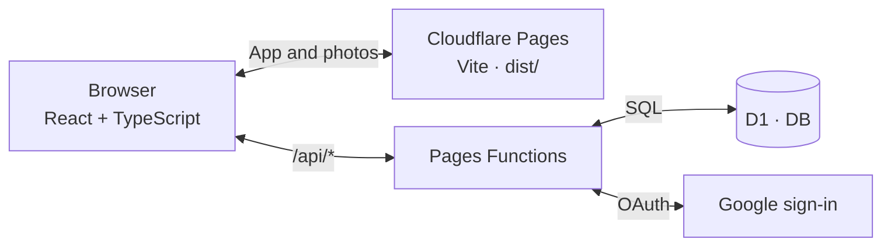

# StudySpot Perth

A library finder for Perth that separates opening hours, personal entry rules and Wi-Fi requirements, helping visitors choose a study spot for their university cards, location and study time.

[**Open StudySpot Perth**](https://studyspotperth.pages.dev)

## Architecture

Cloudflare Pages serves a React single-page app and static photos. Same-origin Pages Functions expose the public catalogue, accounts and publishing; D1 stores library revisions, sessions, preferences and usage records.



1. **Build and delivery:** [src/main.tsx](src/main.tsx) mounts React and the browser router. Vite builds into `dist/`; Pages serves the app, styles and bundled library photos. Page navigation runs in the browser.
2. **Library search:** `/api/catalogue` serves published D1 revisions with ETag revalidation. [Browser search](src/features/libraries/use-catalogue-search.ts) uses shared [domain rules](src/domain/) for Perth schedules, dated exceptions, card access, Wi-Fi and distance. It filters and ranks the catalogue before evaluating each visible page.
3. **Accounts and publishing:** Better Auth handles Google sign-in through `/api/auth/*`. Account APIs keep preferences and favourites tied to the session; server-owned roles protect `/api/admin/*`. Draft snapshots can be previewed before publishing, while public reads continue to use the published revision.
4. **Usage and media:** Optional-cookie consent gates visit and directions statistics through `/api/usage`; administrators read aggregate totals. Statistics use hashed identifiers without raw coordinates. Photos are static assets; D1 stores their paths, credits and sources.

API routing and local/production bindings are defined in [public/_routes.json](public/_routes.json) and [wrangler.jsonc](wrangler.jsonc).

## Technology stack

| Area | Technology | Purpose |
| --- | --- | --- |
| Frontend | React 19, TypeScript 6, React Router 7 | Finder, library details, accounts and administration |
| Build and styling | Vite 8, CSS Modules | Production assets and responsive layouts |
| Hosting and backend | Cloudflare Pages + Pages Functions | Static delivery and same-origin APIs |
| Database | Cloudflare D1 (SQLite), Drizzle ORM | Versioned library facts, sessions, preferences and statistics |
| Authentication | Better Auth, Google OAuth | Cookie sessions and account sign-in |
| Access control | Server-owned roles, same-origin checks | Protected edits and publishing |
| Quality | TypeScript, ESLint, Vitest, Pages/D1 runtime checks | Unit, integration and catalogue-capacity verification |

## Main features

- Perth-time search with open-now, public access, 24/7, university, size, Wi-Fi and facility filters
- 82 authored library records with dated sources, credited photos, opening and entry schedules, and directions
- Optional device location for distance sorting, with filter selections retained in URLs
- Google sign-in, saved libraries and self-reported university-card preferences
- Administrator drafts, preview, publishing and unpublishing, plus consent-controlled usage statistics

Unknown facts remain explicit. Declared cards personalise results; they do not verify university membership or guarantee access.

## Run locally

Requirements: Node.js `>=24` and npm.

```bash
npm ci
npm run dev:setup
npm run types:cloudflare
npm run db:migrate
npm run db:launch
npm run db:catalogue -- --catalogue --link-suburbs --apply
npm run dev:pages
```

Open **http://localhost:8788**. Setup creates an ignored `.dev.vars` with a local auth secret; Google credentials are optional for browsing. Launch imports 13 published listings; the catalogue command adds 69 drafts for administrator review. For frontend live updates, keep the backend running and start `npm run dev` at **http://localhost:5173**.

Checks, including the build, followed by the isolated backend and capacity checks:

```bash
npm run check
npm run test:runtime
npm run test:search-performance
```

## Project map

```text
src/app/          Routing, shared layout and styles
src/features/     Finder, library details, accounts, admin and consent
src/domain/       Schedules, access, Wi-Fi, filtering and ranking
functions/api/    Cloudflare Pages API endpoints
server/           Authentication, repositories and request handlers
migrations/       D1 schema migrations
public/           Static photos, credits and API routing
catalogue/        Sourced library JSON grouped by suburb and university
scripts/          Local setup, imports and runtime/capacity checks
tests/            Fixtures and database integration checks
```

## Documentation

- [Development and operations](docs/development.md) — Google sign-in, local administration, cookies, location and API parameters
- [Catalogue maintenance](docs/catalogue-import.md) — sourced facts, draft imports, size metadata, Wi-Fi profiles and capacity checks
- [Photo credits and licences](public/images/libraries/CREDITS.md)

## Deployment

The app is hosted on [studyspotperth.pages.dev](https://studyspotperth.pages.dev).

```bash
npm run build
npx wrangler pages deploy dist --project-name studyspotperth --branch main
```

Production uses the `env.production` D1 binding and HTTPS auth origin in `wrangler.jsonc`. Configure `AUTH_SECRET`, `GOOGLE_CLIENT_ID` and `GOOGLE_CLIENT_SECRET` as Pages secrets, with the matching Google OAuth callback. [Setup details](docs/development.md#google-sign-in).

Designed, built, tested and deployed by **Chit Thway** in Perth, Western Australia.
